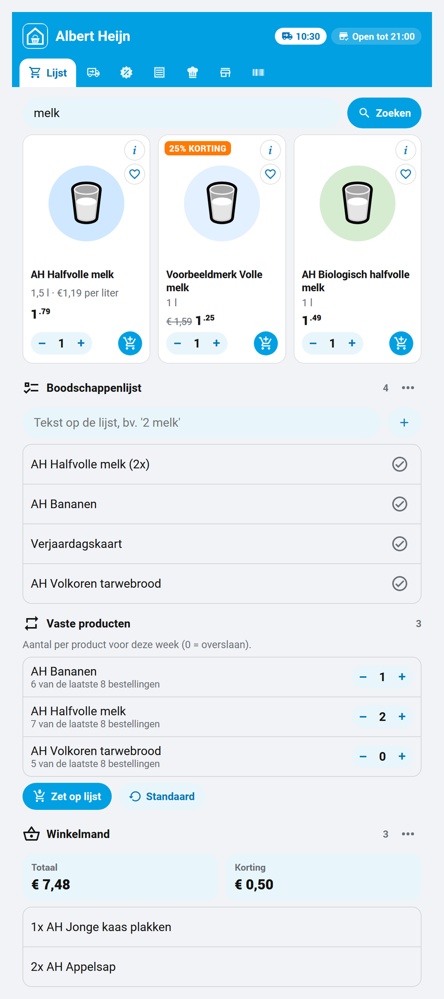
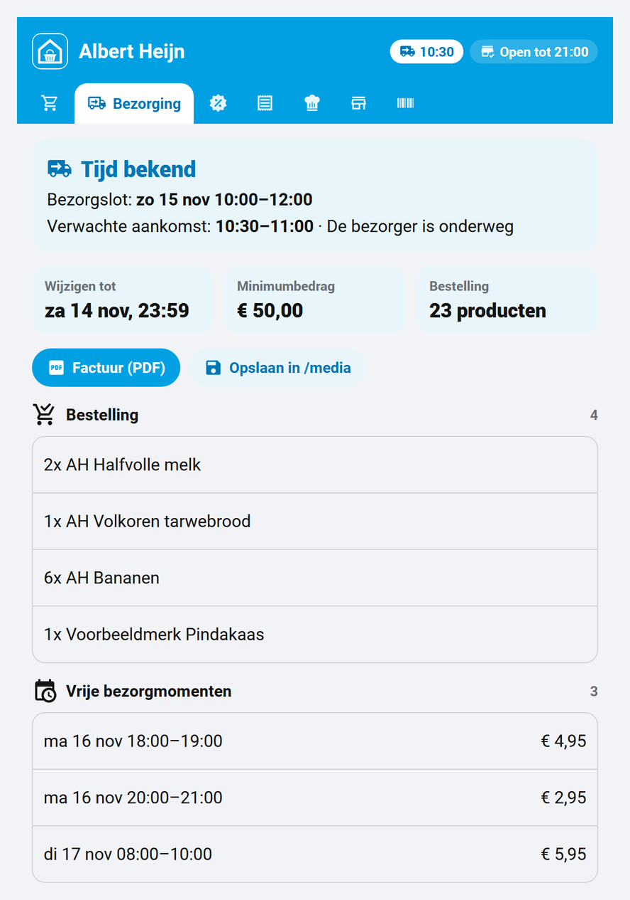
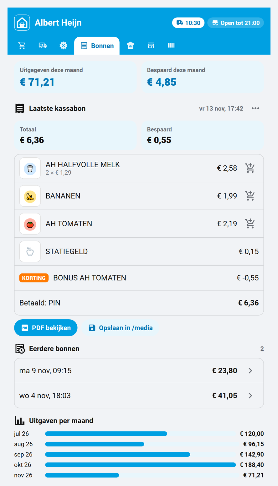
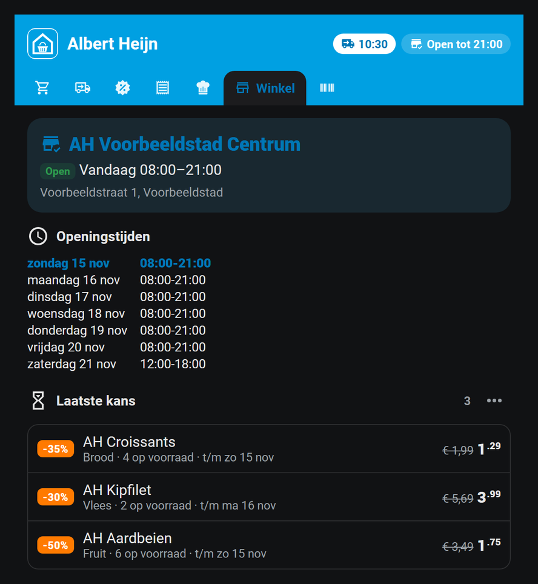

# HA Appie (Home Assistant) · [English below](#english)

Een Home Assistant-integratie voor **Albert Heijn** die veel meer doet dan bezorgmeldingen. Je bedient je boodschappen vanuit je dashboard:

- 🚚 **Bezorging:** status, bezorgslot, verwachte aankomst, *wijzigen tot*, minimumbedrag, factuur als PDF en een event voor meldingen (*"de bezorger komt eraan"*, *"bezorgd"*).
- 🛒 **Boodschappenlijst:** je AH-lijst als to-do in HA. Toevoegen, afvinken en verwijderen; tekst als `courgette` of `2 melk` wordt vanzelf het juiste AH-product.
- 🔁 **Vaste producten:** een weeklijstje van wat je steeds bestelt, met een aanpasbaar aantal per product en één knop om alles op de lijst te zetten.
- 🍝 **Recepten:** opslaan, kiezen in een dropdown, aantal personen instellen en het hele recept met één knop op je lijst zetten, omgerekend naar verpakkingen.
- 🔎 **Producten zoeken:** typ een zoekwoord en kies uit de resultaten, met verpakkingsgrootte, prijs, bonus en prijs per kg of liter.
- 🧾 **Kassabonnen:** de laatste bon met regels, productfoto's en kortingen, bespaard en uitgegeven per maand, elke bon als PDF.
- 🏷️ **Bonus:** persoonlijke Bonus met prijzen en of hij geactiveerd is, Bonus op eerder gekocht.
- 🏪 **Winkel:** je favoriete winkel met openingstijden (open/dicht) en *Laatste kans*-producten in die winkel.
- 🍽️ **Allerhande:** recepten zoeken en als eigen recept overnemen, met de producten die AH erbij voorstelt.
- 💳 **Bonuskaart:** je bonuskaart als barcode op het dashboard (optioneel).
- 🖼️ **Dashboardkaart:** een eigen kaart in AH-stijl met alles hierboven, zonder extra installatie.
- 🛍️ **Overig:** winkelmand met totaal, inhoud van je bestelling, favorietenlijsten, productinformatie en barcode opzoeken.

<table><tr><td></td><td></td><td></td><td></td></tr></table>

*De ingebouwde dashboardkaart, met verzonnen voorbeelddata. Meer schermafbeeldingen (ook van de opties) staan in [`docs/screenshots`](docs/screenshots).*

> ⚠️ **Onofficieel.** Albert Heijn heeft geen publieke API. Deze integratie gebruikt dezelfde API als de AH-app, alleen voor jouw eigen account (hij leest je bestellingen en schrijft alleen naar je boodschappenlijst en, als je dat vraagt, je favorietenlijst; bestellen, annuleren of Bonus activeren doet hij nooit). AH kan dit op elk moment wijzigen of blokkeren, en het gebruik kan tegen hun voorwaarden zijn. Gebruik op eigen risico. Niet verbonden met of goedgekeurd door Albert Heijn.

> ℹ️ **Getest met een echte bezorging (13-11-2026):** de statussen `tijd_bekend` en `bezorgd`. Nog niet getest: `geannuleerd`. Let op: `tijd_bekend` komt al 's nachts, zodra het bezorgslot vaststaat, niet pas als de bezorger onderweg is. Sinds 0.5.0 leest *Verwachte aankomst* het aankomstvenster uit AH's track & trace; dat is nog niet met een echte bezorging getest.

## Installeren

**HACS:** HACS → ⋮ → *Aangepaste repository's* → `https://github.com/HazlittM/ha_appie` (categorie *Integratie*) → installeer → herstart Home Assistant.
**Handmatig:** kopieer `custom_components/ha_appie` naar je `custom_components`-map en herstart.

Daarna: *Instellingen → Apparaten & diensten → Integratie toevoegen → HA Appie*.

## Inloggen (eenmalig)

AH laat inloggen met een app-omleiding toe die een gewone browser niet kan afhandelen. Daarom log je in via een browser en geef je Home Assistant een code door. Het kost een paar minuten, je doet het één keer (en opnieuw als AH je uitlogt).

**Wat je nodig hebt:** een computer (Chrome, Edge of Firefox; op een telefoon lukt het niet) en je AH-account.

1. **Start de installatie in Home Assistant.** Ga naar *Instellingen → Apparaten & diensten → Integratie toevoegen*, zoek op **HA Appie** en kies hem. Er opent een venster "Inloggen bij Albert Heijn" met een tekstveld "Code of omleidings-URL" en een link **de AH-inlogpagina**. Laat dit venster open staan.
2. **Open de AH-inlogpagina op je computer.** Klik op die link (of kopieer hem naar je computerbrowser als je Home Assistant op een telefoon gebruikt). Er opent een nieuw tabblad met de inlogpagina van AH.
3. **Zet de ontwikkelaarstools aan, vóór je inlogt.** Druk in dat AH-tabblad op **F12** (op een Mac: Cmd+Option+I). Aan de zijkant of onderkant opent een paneel. Klik op het tabblad **Netwerk** (Engels: *Network*) en zet het vinkje **Logboek behouden** (*Preserve log*) aan. Zonder dat vinkje verdwijnt het resultaat na het inloggen.
4. **Log in bij AH** met je gewone e-mailadres en wachtwoord (of passkey), in dit tabblad. Dit gaat rechtstreeks naar AH; Home Assistant ziet je wachtwoord niet.
5. **Zoek de code.** Na het inloggen lijkt er niets te gebeuren of er verschijnt een foutmelding. Dat is normaal: de browser probeert de AH-app te openen en dat lukt niet. Typ in het zoekveld ("Filter") van het Netwerk-paneel **`code=`**. Je ziet nu een regel met `login-exit?code=…` (vaak rood of "geannuleerd").
6. **Kopieer hem.** Klik met de rechtermuisknop op die regel → *Kopiëren* → *URL kopiëren* (*Copy → Copy URL*). Lukt dat niet, klik de regel aan en kopieer bij *Headers* de waarde van `location` of de *Request URL*. Je hebt dan iets als `appie://login-exit?code=abc123…`. Alleen het stuk na `code=` plakken mag ook.
7. **Plak het in Home Assistant** in het veld "Code of omleidings-URL" en kies *Verzenden*. Doe dit meteen: de code is maar kort geldig en werkt één keer.

Klaar: de integratie maakt de apparaten en entiteiten aan. Krijg je "Code afgewezen"? Dan was de code verlopen of al gebruikt: begin opnieuw bij stap 2 voor een nieuwe code.

Je wachtwoord komt nooit in Home Assistant, alleen de tokens (in `.storage`). Adres, telefoonnummer en geboortedatum worden niet gelezen. Is je inlog later verlopen, dan vraagt Home Assistant zelf om opnieuw in te loggen met dezelfde stappen.

## Entiteiten

De ID's zijn de standaardnamen (`…ha_appie_…`); je kunt ze aanpassen.

| Entiteit | Betekenis |
|---|---|
| `sensor.ha_appie_status` | `geen`, `gepland`, `tijd_bekend`, `bezorgd`, `geannuleerd`, `onbekend` |
| `sensor.ha_appie_begin_bezorgslot` / `…_einde_bezorgslot` | je geboekte bezorgslot |
| `event.ha_appie_bezorging` | vuurt af bij `tijd_bekend`, `bezorgd`, `geannuleerd` |
| `todo.ha_appie_boodschappenlijst` | je AH-lijst; afvinken **verwijdert** het item (AH kent geen "afgevinkt") |
| `number.ha_appie_<product>` + `button.ha_appie_voeg_vaste_producten_toe_aan_boodschappenlijst` | vaste producten en de knop om ze op de lijst te zetten |
| `text.ha_appie_zoek_product`, `select.ha_appie_zoekresultaat`, `number.ha_appie_zoek_aantal`, `button.ha_appie_zoekresultaat_toevoegen` | producten zoeken |
| `select.ha_appie_recept`, `number.ha_appie_recept_personen`, `todo.ha_appie_recept_ingredienten`, `button.ha_appie_recept_op_boodschappenlijst` | recepten |
| `text.ha_appie_nieuw_recept_*`, `number.ha_appie_nieuw_recept_personen`, `button.ha_appie_nieuw_recept_opslaan` | nieuw recept invullen |
| `todo.ha_appie_vertaallijst` | eigen vertalingen voor productnamen |
| `sensor.ha_appie_winkelmand`, `…_producten_in_bestelling`, `…_laatste_kassabon`, `…_bedrag_laatste_kassabon`, `…_uitgegeven_in_winkel_deze_maand`, `…_persoonlijke_bonus`, `…_bonus_op_eerder_gekocht` | winkelmand (met totaal), bestelling, kassabonnen (laatste bon met regels, eerdere bonnen, uitgaven per maand), Bonus (elke 30 min ververst; lijsten staan in attributen en niet in de database) |
| `sensor.ha_appie_verwachte_aankomst`, `…_bestelling_wijzigen_tot` | aankomstvenster op de bezorgdag; tot wanneer je de bestelling kunt wijzigen (met minimumbedrag) |
| `sensor.ha_appie_bespaard_in_winkel_deze_maand` | kortingen op je kassabonnen deze maand |
| `sensor.ha_appie_favoriete_winkel`, `…_laatste_kans` | `open`/`dicht` met openingstijden; afgeprijsde producten in die winkel (elk uur ververst) |
| `sensor.ha_appie_favorieten` | je favorietenlijsten |
| `sensor.ha_appie_bonuskaart` | optioneel: je bonuskaart (gemaskeerd; het nummer voor de barcode staat niet in de database) |
| `sensor.ha_appie_eerste_vrije_bezorgmoment` | optioneel: vrije bezorgmomenten voor het adres dat je in de opties invult |

**Privacy:** boodschappen en bonnen zijn zichtbaar voor iedereen die je Home Assistant kan zien. De status ververst elke minuut op een bezorgdag, anders elke 15 minuten.

**Opties.** *Instellingen → Apparaten & diensten → HA Appie → Configureren*: elk onderdeel hierboven staat apart aan of uit (de bonuskaart en vrije bezorgmomenten staan standaard uit). Levert AH een onderdeel niet, dan wordt die entiteit *niet beschikbaar*; de rest blijft werken. Vrije bezorgmomenten hebben een adres nodig: de integratie leest je adres nooit bij AH, je vult het daar zelf in.

## Gebruik

**Vaste producten.** De integratie kijkt naar je laatste 8 afgeronde bezorgingen en maakt een lijst van producten die je in minstens de helft bestelde (max. 30). Elk product krijgt een `number` met het gebruikelijke aantal; zet het op 0 om het deze week over te slaan. De knop zet alles met een aantal groter dan 0 op de lijst; wat er al staat wordt overgeslagen, dus twee keer drukken verdubbelt niets.

**Slim toevoegen.** Typ je in de to-do `Courgette`, dan wordt het `AH Courgette`. Eerst wat je eerder bestelde, dan een exacte naam, dan AH-eigen merk en de kortste naam. Past niets, dan blijft je tekst staan. Aantallen werken ook: `2 melk`, `melk 2x`.

**Producten zoeken.** Typ een zoekwoord in *Zoek product*, kies het resultaat, stel het aantal in en druk op *Zoekresultaat toevoegen*. Staat het al op de lijst, dan wordt het aantal opgeteld.

**Recepten.**
- *Invullen:* vul *Nieuw recept naam*, *personen* en *ingrediënten* in (met `;` ertussen, bv. `500 gr gehakt; 2 uien; 1 zak rijst`) en druk op *Nieuw recept opslaan*. Of gebruik de actie `ha_appie.save_recipe` (`name`, `persons`, `ingredients` één per regel; een recept van internet plakken mag).
- *Gebruiken:* kies het recept in *Recept*, stel *Recept personen* in (herrekent alles) en druk op *Recept op boodschappenlijst*. In *Recept ingrediënten* voeg je regels toe, pas je ze aan of verwijder je ze; dat wijzigt het recept.
- *Verpakkingen:* hoeveelheden worden omhoog afgerond op de verpakking (`600 g` met 500 g-verpakkingen = 2). Lepels, blikjes en ingrediënten zonder hoeveelheid worden 1 verpakking.
- *Productkeuze:* elk ingrediënt wordt het AH-product dat er het meest op lijkt ("lays paprika chips" wordt "Lay's Paprika"). Minstens 60% van je woorden moet in de naam staan, bij elkaar en zonder woorden erachter ("Rode bieten met ui" is dus geen "rode ui", "Pasta Pestosaus" geen "pasta"). Eerder gekochte producten gaan voor; kleine typefouten en meervouden worden herkend. Past niets, dan komt het als tekst op de lijst.
- *Zelf kiezen:* zoek het product, kies het ingrediënt bij *Recept ingrediënt kiezen* en druk op *Zoekresultaat vastzetten bij ingrediënt* (📌). *Ingrediënt weer automatisch kiezen* haalt dat weg.
- *Vertaallijst:* lukt een woord toch niet, zet dan een regel als `cremé fraise = creme fraiche` in de lijst *Vertaallijst* (links wat jij typt, rechts wat AH kent). Persoonlijk en alleen in je eigen HA-opslag.
- Ook beschikbaar: `ha_appie.add_recipe_to_list` (optioneel `persons`) en `ha_appie.delete_recipe`.

**Dashboardkaart.** De integratie registreert zelf een kaart; je hoeft niets te installeren. Kies op je dashboard *Kaart toevoegen → HA Appie* (of `type: custom:ha-appie-card`). Tabbladen: Lijst (zoeken met foto's, boodschappenlijst, vaste producten, winkelmand), Bezorging, Bonus, Bonnen (laatste bon met foto's, PDF, eerdere bonnen, uitgaven per maand), Recepten (eigen recepten en Allerhande), Winkel (openingstijden, Laatste kans) en Bonuskaart. In de visuele editor kies je de titel, het starttabblad, welke tabbladen je ziet, productfoto's aan/uit en het aantal tegels. Licht en donker volgen je HA-thema; op een telefoon worden de tabbladen iconen. Met `?appie_tab=bonus` in de URL open je direct een tabblad.

```yaml
type: custom:ha-appie-card
title: Albert Heijn
default_tab: list   # list, delivery, bonus, receipts, recipes, store, card
show_receipts: true # een tabblad verbergen: show_<tab>: false
show_images: true   # productfoto's komen van static.ah.nl
max_items: 12
```

**Kassabonnen en facturen als PDF.** In de kaart *PDF bekijken* of *Opslaan in /media*. Als actie: `ha_appie.save_receipt_pdf` en `ha_appie.save_invoice_pdf` (`id`: bon-id of bestelnummer, of `latest`; `folder`: standaard `/media/ha_appie`, alleen toegestane mappen).

**Allerhande.** `ha_appie.search_recipes` (`query`) geeft recepten terug, `ha_appie.get_recipe` (`recipe_id`) de ingrediënten en bereiding, en `ha_appie.import_recipe` slaat er een eigen recept van op, met de producten die AH bij elk ingrediënt voorstelt vastgezet. Daarna werkt het als elk ander recept.

**Overige acties** (allemaal met antwoord, handig in scripts): `ha_appie.search_products`, `ha_appie.add_product` (`product_id`, `quantity`; telt op bij wat er al op de lijst staat), `ha_appie.product_details` (`product_id` of `barcode`: Nutri-Score, voedingswaarde, prijs, foto), `ha_appie.get_receipt` en `ha_appie.add_to_favorites`.

## Voorbeelden

In de map [`examples/`](examples):

- [`automations.yaml`](examples/automations.yaml): bezorgmelding (aankomsttijd bekend + bezorgd), vaste producten de dag voor de bezorging op de lijst, een recept op de lijst via een tag, en snel toevoegen met `todo.add_item`.
- [`dashboard.yaml`](examples/dashboard.yaml): complete bediening (vaste producten, recepten, nieuw recept, zoeken, lijsten) met alleen standaardkaarten.
- [`dashboard-popup-bubble-card.yaml`](examples/dashboard-popup-bubble-card.yaml): dezelfde bediening als pop-up met [Bubble Card](https://github.com/Clooos/Bubble-Card).

Bezorgmelding in het kort:

```yaml
automation:
  - alias: Albert Heijn bezorgd
    triggers:
      - trigger: state
        entity_id: sensor.ha_appie_status
        to: bezorgd
    actions:
      - action: notify.mobile_app_JOUW_TELEFOON
        data: {title: Albert Heijn, message: Je boodschappen zijn bezorgd.}
```

## Problemen

- *"Code afgewezen"*: de code is verlopen of al gebruikt. Log opnieuw in en plak meteen.
- *Tweestapsverificatie (2FA) aan op je AH-account*: het 2FA-scherm verschijnt heel even en crasht dan ("Application error: a client-side exception"). Er komt dan geen code. Zet 2FA in je AH-account tijdelijk uit, log in volgens de stappen hierboven en zet 2FA daarna direct weer aan. Home Assistant werkt verder met de opgeslagen sessie; alleen als AH je later uitlogt moet je dit herhalen.
- *Ander account koppelen*: verwijder eerst de oude integratie en voeg dan de nieuwe toe. Andersom krijgen alle entiteiten `_2` achter hun naam en werken je dashboards en automations niet meer (terug te zetten via de entiteitsinstellingen).
- Verandert AH de API, dan ziet Home Assistant een fout of lege status. Alle AH-specifieke code staat in `api.py` en `model.py`.
- *Verwachte aankomst* komt uit AH's track & trace en is alleen op de bezorgdag gevuld. Blijft hij leeg terwijl de AH-app een tijd toont, open dan een issue.
- Een onderdeel blijft *niet beschikbaar*? Zet debuglogging aan voor `custom_components.ha_appie`; je ziet dan welk AH-verzoek niet lukt. Je kunt het onderdeel in de opties uitzetten.

## Ontwikkelen

`python3 tests/test_model.py` en `python3 tests/test_details.py` draaien de tests (geen Home Assistant nodig). Wijzigingen staan in [CHANGELOG.md](CHANGELOG.md). Licentie: MIT.

---

## English

A Home Assistant integration for **Albert Heijn** that does far more than delivery notifications. Run your grocery shopping from your dashboard:

- 🚚 **Delivery:** status, time slot, expected arrival, change-until time, minimum order value, invoice PDF and an event for notifications ("arrival time known", "delivered").
- 🛒 **Shopping list:** your AH list as a to-do in HA. Add, tick off, remove; text like `courgette` or `2 melk` becomes the right AH product.
- 🔁 **Regular products:** a weekly list of what you keep ordering, an adjustable quantity per product and one button to put it all on the list.
- 🍝 **Recipes:** store them, pick one from a dropdown, set the persons and put the whole recipe on your list with one button, converted to pack counts.
- 🔎 **Product search:** type a keyword and pick a result, with pack size, price, bonus and price per kg or litre.
- 🧾 **Receipts:** the latest receipt with lines, product photos and discounts, saved and spent per month, every receipt as a PDF.
- 🏷️ **Bonus:** personal Bonus with prices and activation status, Bonus on previously bought.
- 🏪 **Store:** your favourite store with opening hours (open/closed) and *Last chance* products in that store.
- 🍽️ **Allerhande:** search recipes and import them as your own, with the products AH proposes.
- 💳 **Bonus card:** your bonus card as a barcode on the dashboard (optional).
- 🖼️ **Dashboard card:** a built-in card in AH style with everything above, nothing extra to install.
- 🛍️ **Also:** basket with total, order contents, favourite lists, product information and barcode lookup.

<table><tr><td></td><td></td><td></td><td></td></tr></table>

*The built-in dashboard card, with made-up sample data. More screenshots (including the options) are in [`docs/screenshots`](docs/screenshots).*

> ⚠️ **Unofficial.** AH has no public API. This uses the same API as the AH app, for your own account only (it reads your orders and only writes to your shopping list and, when you ask, your favourite list; it never orders, cancels or activates Bonus). It can break or be blocked at any time and may be against AH's terms. Use at your own risk. Not affiliated with Albert Heijn.

> ℹ️ **Tested with a real delivery (2026-11-13):** the statuses `tijd_bekend` and `bezorgd`. Not yet tested: `geannuleerd`. Note: `tijd_bekend` arrives at night as soon as the slot is fixed, not when the driver is on the way. Since 0.5.0 *Expected arrival* reads the arrival window from AH's track & trace; not yet tested with a real delivery.

**Install:** HACS → ⋮ → *Custom repositories* → `https://github.com/HazlittM/ha_appie` (type *Integration*) → install → restart. Or copy `custom_components/ha_appie`. Then *Settings → Devices & services → Add integration → HA Appie*.

**Login (once):** AH uses an app redirect that a normal browser cannot handle, so you log in in a browser and hand Home Assistant a code. You need a computer (Chrome, Edge or Firefox; a phone does not work).
1. In Home Assistant: *Settings → Devices & services → Add integration → HA Appie*. A dialog "Inloggen bij Albert Heijn" opens with a field "Code of omleidings-URL" and a link to the AH login page. Keep it open.
2. Open that link in a browser on your computer.
3. **Before logging in,** press **F12** (Mac: Cmd+Option+I), open the **Network** tab and tick **Preserve log**.
4. Log in to AH in that tab. Your password goes straight to AH, not to Home Assistant.
5. After login nothing seems to happen, or you see an error: that is normal, the browser tries to open the AH app. Type **`code=`** in the Network filter box and look for a request `login-exit?code=…` (often red or "cancelled").
6. Right-click it → *Copy → Copy URL* (or copy the `location` header from *Headers*). You get `appie://login-exit?code=abc123…`; only the part after `code=` also works.
7. Paste it in the Home Assistant dialog and submit straight away: the code is short-lived and single-use. "Code afgewezen" means it expired or was used: repeat from step 2.

**Two-factor authentication (2FA) on your AH account:** the 2FA screen flashes briefly and then crashes ("Application error: a client-side exception"), so no code appears. Turn 2FA off in your AH account for a moment, log in with the steps above and turn 2FA back on right away. Home Assistant keeps using the stored session; you only repeat this if AH logs you out later. To switch to another account, remove the old integration first and then add the new one; otherwise every entity gets `_2` appended and your dashboards and automations break.

Only tokens are stored (in `.storage`); address, phone number and date of birth are not read. If your login expires later, Home Assistant asks you to log in again with the same steps.

**Entities:** see the table in the Dutch section; IDs are the defaults (`…ha_appie_…`). Ticking off a to-do item **removes** it (AH has no "ticked"). Receipts, basket and Bonus refresh every 30 minutes; store, last chance, favourites and bonus card every hour; status every minute on a delivery day, otherwise every 15 minutes.

**Options** (*Settings → Devices & services → HA Appie → Configure*): every part can be switched off; the bonus card and free delivery slots are off by default. Free slots need an address you type there yourself (it is never read from AH). If AH does not provide a part, that entity becomes unavailable and the rest keeps working.

**Usage**
- *Regular products:* products you ordered in at least half of your last 8 deliveries (max 30), each with a quantity `number` (0 = skip this week) and one button that adds them to the list (items already on the list are skipped).
- *Smart add:* typing `Courgette` in the to-do becomes `AH Courgette`; `2 melk` and `melk 2x` work. If nothing fits, your text stays as typed.
- *Search:* type a keyword in *Zoek product*, pick a result, set the quantity, press *Zoekresultaat toevoegen*.
- *Recipes:* fill the *Nieuw recept* form (ingredients separated by `;`) or call `ha_appie.save_recipe`; pick the recipe, set the persons (rescales everything) and press *Recept op boodschappenlijst*. Amounts are rounded up to whole packs. Each ingredient gets the AH product that best matches it (at least 60% of your words in the name, together, nothing after them; products you bought before win; typos are tolerated), otherwise it is added as text. Pin a product per ingredient with *Zoekresultaat vastzetten bij ingrediënt*, or add a personal rule like `cremé fraise = creme fraiche` to the *Vertaallijst* to-do. Also available: `ha_appie.add_recipe_to_list` and `ha_appie.delete_recipe`.

- *Dashboard card:* the integration registers its own card: *Add card → HA Appie* (`type: custom:ha-appie-card`). Tabs: list, delivery, bonus, receipts, recipes, store, bonus card; a visual editor sets title, start tab, visible tabs, product photos and tile count. `?appie_tab=<tab>` in the URL opens a tab.
- *PDFs:* `ha_appie.save_receipt_pdf` / `ha_appie.save_invoice_pdf` (`id` or `latest`, `folder` default `/media/ha_appie`), or *Open PDF* in the card.
- *Allerhande:* `ha_appie.search_recipes`, `ha_appie.get_recipe`, `ha_appie.import_recipe` (saves it as your own recipe with AH's product suggestions pinned).
- *More actions with a response:* `ha_appie.search_products`, `ha_appie.add_product`, `ha_appie.product_details` (by `product_id` or `barcode`), `ha_appie.get_receipt`, `ha_appie.add_to_favorites`.

**Examples** are in [`examples/`](examples): automations, a dashboard using core cards only, and a Bubble Card pop-up. **Changes:** [CHANGELOG.md](CHANGELOG.md). **Tests:** `python3 tests/test_model.py` and `python3 tests/test_details.py`. **License:** MIT.
